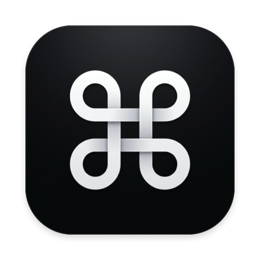
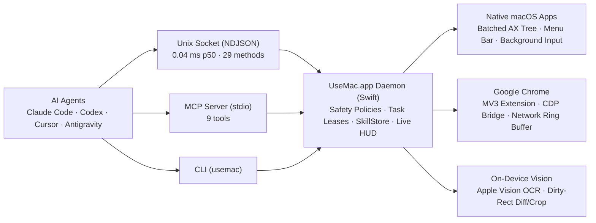

<div align="center">
  

  <h1>UseMac</h1>

  <p><strong>Let AI agents work in your Mac apps and Chrome tabs while you keep using your Mac.</strong></p>

  <p>
    UseMac is a native, open-source Swift app. Agents can read and act through macOS Accessibility or the Chrome extension, with a live preview and controls for what they can access.
  </p>

  <p>
    <a href="https://usemac.app"></a>
    
    
    <a href="LICENSE"></a>
  </p>

  <p>
    <a href="https://usemac.app">Download</a> ·
    <a href="#why-usemac">Why UseMac</a> ·
    <a href="#install">Install</a> ·
    <a href="#how-agents-connect">Connect Agents</a> ·
    <a href="#safety-model">Safety</a> ·
    <a href="#benchmarks">Benchmarks</a> ·
    <a href=".agents/AGENTS.md">Agent Guide</a>
  </p>
</div>

---

## Why UseMac

UseMac works with the apps and Chrome profiles you already use. It reads structured UI data when it can and uses screenshots and on-device Apple Vision OCR when it needs to see the screen. The automation engine runs on your Mac; where your agent processes the results depends on the client you connect.

Most supported actions run in the background. Some native actions and restricted Chrome pages need a visible window or a brief, opt-in switch to the foreground. UseMac waits for you to be idle before sending foreground input.

| Capability | What it gives your agents |
| :--- | :--- |
| **Fewer LLM turns, lower token tax** | Piggybacked task lifecycle, `browser_open` with inline `steps` + `autoDismissOverlays`, compound resilient steps (`fillForm`, `scrollUntil`, `assert`, `optional`, `menuAction`), auto-delta observations, reusable `SkillStore` macros, a compact 9-tool MCP schema, and a ≤ 5.5 KB core skill. |
| **Sub-millisecond local IPC & batched AX** | `0.04 ms` p50 Unix socket round trips with concurrent pipelining, `AXUIElementCopyMultipleAttributeValues` batching, background `AXObserver` wakes, and `app_menu` direct menu invocation ([benchmarks](#benchmarks)). |
| **Background app and tab control** | Use Accessibility (`@e1..@eN`) in native apps and a Chrome extension (`@b1..@bN`) for DOM actions, file inputs, captured XHR/Fetch JSON (`mode: "network"`), and parallel `browser_batch` reads. |
| **Instant Apple Vision OCR + dirty-rect diff/crop** | Zero-setup on-device Apple Vision OCR (`~20 ms` negation-safe `verify`, automatic `@v1..@vN` OCR fusion on AX-blind windows) and `16×10` tile `diffCrop` screenshots — zero Python/MLX downloads or GBs of RAM. |
| **Separate tasks, one live preview** | Each task keeps its own window selection and tabs. The preview shows which agent is working where and centers wide pages without resizing the tab. |
| **Local-first safety controls** | Five execution modes, physical-click-only **Ask** approvals, instant `⇧⌘⎋` Kill Switch, Keychain-sealed safety settings, default credential/password-manager guards, and a redacted local audit log. |
| **One engine, three transports** | Connect over raw Unix domain socket (NDJSON), a native `stdio` MCP server, or the `usemac` CLI — all governed by the exact same daemon and safety policies. |

## How it works



## Requirements

- **macOS 15** or later
- **Apple Silicon** (`arm64`)
- **Google Chrome** (120 or later) for background browser tab automation

## Install

Download the stable DMG from **[usemac.app](https://usemac.app)**, see [all GitHub releases](https://github.com/diegosquid/usemac/releases), or [build from source](#build-from-source):

1. **Install the app** — Drag `UseMac.app` into `/Applications` and open it.
2. **Grant permissions** — Enable **Accessibility** and **Screen Recording** in **UseMac → Settings → General → Permissions**.
3. **Add & pair the Chrome extension** — In `chrome://extensions`, enable **Developer mode**, click **Load unpacked**, and select `/Applications/UseMac.app/Contents/Resources/chrome-extension`. If your build offers **Open Web Store** in the setup guide, you can install it there instead. Pair each Chrome profile once: open **UseMac → Settings → General → Chrome Extension**, click **Copy key**, and paste the `umk_…` key into the extension popup.
   - *Updating the extension*: After a UseMac update, **Settings → Chrome Extension** flags profiles running an older copy or one loaded from another folder. For an older bundled copy, click **Reload** there, or run `usemac browser reload-extension` (socket method `browser_reload_extension`; fails with `EXTENSION_RELOAD_UNSUPPORTED` on an extension too old to reload itself, `BROWSER_BUSY` while agents are using Chrome, or `EXTENSION_RELOAD_TIMEOUT` if it doesn't reconnect). If the source is `other_folder`, load the bundled folder instead: reloading the external copy does not pick up app updates, even if the versions match.
4. **Connect your AI agent** — Open **UseMac → Settings → Connect** and paste the setup prompt into your agent, or install the bundled skill directly:
   ```bash
   /Applications/UseMac.app/Contents/Helpers/usemac install-skill
   ```

## How agents connect

### Unix socket (NDJSON)

The fastest transport — zero MCP schema overhead and concurrent pipelining over a single persistent connection. `UseMac.app` listens on `/tmp/usemac-$UID/usemac.sock` (override with `USEMAC_SOCKET`), inside a directory only your user can open. If the socket file is removed while the app runs, UseMac recreates it within 30 seconds. Connections are restricted to the same macOS user, and requests over 16 MiB are rejected (`message_too_large`). `id` is optional on requests; any request accepts piggybacked `taskStart`/`taskComplete`; boolean fields on `act` default to `stopOnError: true`, `returnObservation: true`, `returnDiffOnly: false`, and `includeScreenshot: false`.

```bash
printf '{"id":"1","method":"status"}\n' | nc -U "/tmp/usemac-$(id -u)/usemac.sock"
```

**Methods (29):**

| Category | Methods |
| :--- | :--- |
| **Core & native apps** | `ping`, `status`, `list_apps`, `observe`, `act`, `screenshot`, `highlight`, `pair_app`, `app_menu` |
| **Chrome bridge** | `browser_status`, `browser_tabs`, `browser_open`, `browser_observe`, `browser_extract`, `browser_screenshot`, `browser_act`, `browser_batch`, `browser_reload_extension` |
| **On-device vision & skills** | `vision_status`, `vision_query`, `skill_save`, `skill_run`, `skill_list` |
| **Tasks, safety & diagnostics** | `task_start`, `task_complete`, `set_policy`, `audit_log`, `report_prepare`, `debug_capture` |

See the [Agent Guide](.agents/AGENTS.md#3-unix-socket-ndjson) for schemas and examples of each method. `debug_capture` is only for developing UseMac itself and works only after you turn on **Debug capture** in Settings ([Agent Guide, section 9](.agents/AGENTS.md#9-debug-capture-developing-usemac)).

### MCP (`stdio`)

Register the bundled helper binary under the `"usemac"` key in your MCP client configuration (Claude Code, Cursor, Codex, Antigravity, Claude Desktop):

```json
{
  "mcpServers": {
    "usemac": {
      "command": "/Applications/UseMac.app/Contents/Helpers/usemac",
      "args": ["mcp"]
    }
  }
}
```

Every MCP tool carries `annotations` (`readOnlyHint`, `destructiveHint`), returns inline `.image` blocks on both native and browser visual calls when requested, and never automatically retries a mutating action on timeout.

**Exposed tools (9):**

| Category | Tools |
| :--- | :--- |
| **Observe & act (native + Chrome)** | `usemac_observe`, `usemac_act`, `usemac_screenshot` |
| **Chrome navigation & extraction** | `usemac_browser_open`, `usemac_browser_extract` |
| **Discovery, vision, skills & session** | `usemac_discover`, `usemac_vision`, `usemac_skill`, `usemac_session` |

*Backwards-compatible legacy aliases* (still accepted on `tools/call`): `usemac_status`, `usemac_list_apps`, `usemac_browser_tabs`, `usemac_browser_observe`, `usemac_browser_act`, `usemac_browser_screenshot`, `usemac_vision_status`, `usemac_vision_query`, `usemac_task_start`, `usemac_task_complete`, `usemac_highlight`, `usemac_report_prepare`.

### CLI (`usemac`)

```bash
USEMAC="/Applications/UseMac.app/Contents/Helpers/usemac"
"$USEMAC" status
"$USEMAC" observe --app "Notes" --filter-role button
"$USEMAC" observe --app "Notes" --include-offscreen
"$USEMAC" menu --app "Notes" --query "New"
"$USEMAC" act '{"app":"Notes","observationMode":"auto","steps":[{"action":"type","text":"Meeting notes","preferBackground":true}]}'
"$USEMAC" browser open "https://example.com" --auto-dismiss
"$USEMAC" browser extract network --url-filter "/api/"
"$USEMAC" --json browser extract downloads
"$USEMAC" skill list
"$USEMAC" audit --since 2h
"$USEMAC" install-skill
"$USEMAC" debug capture --window preview --context   # developing UseMac only, once Debug capture is on
```

`usemac --json browser extract downloads` returns the array at `.downloads`; on the socket it is `browserExtract.downloads`, not `jsonResult`.

Chrome click results distinguish a dispatched click from an observed effect. If a click is covered or produces no observable result, read the step's `effect` and `warning` and check the page before trying again. UseMac does not automatically repeat the click.

When `UseMac.app` is closed, the CLI and MCP server run in read-only mode and mutating requests return `DAEMON_REQUIRED`. Passing `--standalone` runs in-process without the app and without its safety controls.

### Error codes

Failed requests return an error `code`, a `message`, and an optional `hint` when UseMac knows what the agent should do next (for `POLICY_BLOCKED`, which mode, pause, or Kill Switch refused it). See the [Agent Guide](.agents/AGENTS.md#error-codes) for full recovery rules.

| Category | Codes |
| :--- | :--- |
| **Stop and tell the user** *(safety rule, approval, or daemon closed)* | `POLICY_BLOCKED`, `POLICY_LOCKED`, `APPROVAL_DENIED`, `APPROVAL_TIMEOUT`, `TARGET_BLOCKED`, `URL_BLOCKED`, `UPLOAD_BLOCKED`, `SELF_TARGET_BLOCKED`, `IMAGE_PATH_BLOCKED`, `DEBUG_CAPTURE_OFF`, `DAEMON_REQUIRED` |
| **Screen changed or check failed** *(observe again)* | `STALE_SNAPSHOT`, `ELEMENT_NOT_FOUND`, `WAIT_TIMEOUT`, `ASSERTION_FAILED`, `FORM_FILL_FAILED`, `MENU_NOT_FOUND`, `SKILL_NOT_FOUND` |
| **App in background, user active, or target leased** | `TARGET_NOT_FRONTMOST`, `USER_ACTIVE`, `TARGET_BUSY` |
| **Wrong route** *(switch to native observe / hybrid Chrome flow)* | `RESTRICTED_PAGE`, `CAPTURE_TOO_SMALL` |
| **Chrome extension** | `EXTENSION_NOT_CONNECTED`, `EXTENSION_NOT_PAIRED`, `EXTENSION_TIMEOUT`, `EXTENSION_RELOAD_UNSUPPORTED`, `EXTENSION_RELOAD_TIMEOUT`, `BROWSER_BUSY`, `NO_USEMAC_TAB`, `CANCELLED`, `WINDOW_ERROR`, `EVAL_ERROR` |
| **Apps, permissions & captures** | `APP_NOT_FOUND`, `PERMISSION_DENIED`, `CAPTURE_FAILED`, `UPLOAD_FAILED`, `NO_IMAGE_SOURCE` |
| **Problem reports** | `REPORT_IN_REVIEW` *(another report is still open for review; see [How to contribute](#how-to-contribute))* |
| **Malformed or unsupported requests** | `USAGE`, `INVALID_JSON`, `INVALID_REQUEST`, `INVALID_ARGUMENT`, `UNKNOWN_COMMAND`, `NOT_IMPLEMENTED` |
| **Unexpected failures** | `INTERNAL`, `ENCODING_FAILED`, `EXTENSION_ERROR`, `BROWSER_TABS_FAILED`, `BROWSER_OPEN_FAILED`, `BROWSER_OBSERVE_FAILED`, `BROWSER_EXTRACT_FAILED`, `BROWSER_SCREENSHOT_FAILED`, `BROWSER_ACT_FAILED`, `BROWSER_BATCH_FAILED`, `APP_MENU_FAILED`, `SKILL_SAVE_FAILED`, `SKILL_RUN_FAILED` |

## Safety model

### Execution modes

UseMac starts in **Autonomous** until you choose another mode in **Settings → General → Safety**. Any other mode shows in the menu bar: Read-only badges the icon with an eye, Paused and the Kill Switch with pause bars, and the menu shows "Mode: …" with a shortcut back to Safety. Requests refused by a mode return `POLICY_BLOCKED` with a `hint` telling the agent to ask you.

| Mode (`set_policy`) | App UI label | Behavior |
| :--- | :--- | :--- |
| `autonomous` | **Autonomous** | Allows all actions (still subject to URL, upload, and path guards). |
| `ask` | **Ask** | Holds `uploadFile`, keyboard shortcuts using `⌘` or `⌃` (any spelling), and `browser_extract` in `eval` mode until you click **Allow once** or **Deny** in a prompt next to the HUD. Deny returns `APPROVAL_DENIED`; no answer within 45 s returns `APPROVAL_TIMEOUT`. |
| `confirmSensitive` | **Block sensitive** | Blocks `uploadFile`, keyboard shortcuts using `⌘` or `⌃` (whatever the spelling: `cmd`, `command`, `meta`, `ctrl`, `control`), and `browser_extract` in `eval` mode. |
| `readOnly` | **Read-only** | Blocks mutating actions; `scroll`, `hover`, `wait`, `assert`, `target`, observe, `app_menu` search, `skill_list`, read-only extract (`auto`, `tables`, `text`, `kpis`, `network`, `downloads`), and screenshots remain allowed. |
| `paused` | **Paused** | Blocks all automation, including reads. |

### Guardrails & isolation

- **Global Kill Switch (`⇧⌘⎋`)**: Immediately halts all automation (including reads) and cancels any in-progress Chrome batch. While **Kill Switch** or **Paused** is active, only `ping`, `status`, `audit_log`, `browser_status`, `vision_status`, `task_start`, and `task_complete` respond; everything else returns `POLICY_BLOCKED`. `report_prepare` also works while **Paused** (it only opens UseMac's own review window), but not with the Kill Switch on.
- **One-way socket policy & tamper-evident seal**: `set_policy` over the socket can only keep or tighten the execution mode; relaxing it returns `POLICY_LOCKED` (only the app UI can relax it). Execution mode, Kill Switch state, Debug capture, app and site rules, and Record typed text are sealed with a key in your login Keychain — if modified outside UseMac, UseMac relaunches **Paused** with default rules, Debug capture off, and Record typed text off until you resume.
- **Ask prompts answer only to physical input**: Only a real click from your Mac's mouse or trackpad answers an Ask prompt. Clicks posted by any process (another agent, Screen Sharing, Universal Control, Voice Control) and Accessibility actions are ignored, there is no RPC/MCP tool for it, and every answer or ignored click is logged. One prompt shows at a time; others queue.
- **Blocked by default**:
  - **URLs**: `browser_open`, `browser_batch`, and `openURL`/`navigate` accept only `http://`, `https://`, and `about:blank` (scheme-less URLs default to `https://`; everything else returns `URL_BLOCKED`).
  - **Sensitive file uploads**: `uploadFile` blocks `~/.ssh`, `~/.aws`, `~/.gnupg`, Keychains, `.env` files, browser and password-manager folders in `~/Library`, shell histories, and secret/key extensions (`.pem`, `.pfx`, `.p8`, `.kdbx`, `.ovpn`, `.jks`, `.keystore`, `.tfstate`), returning `UPLOAD_BLOCKED`.
  - **UseMac's own windows**: Agents cannot observe or act on UseMac itself (Settings, setup guide). Targeting it returns `SELF_TARGET_BLOCKED`, and `list_apps` omits it.
  - **Debug capture** (**Settings → General → Developer**, off by default): Strictly for developing UseMac. While on, agents can take read-only PNG screenshots of UseMac's own windows and surrounding screen (`debug_capture`, CLI `usemac debug capture`), but still cannot click or type in them. Only your physical click on **Turn On** enables it; while off, `debug_capture` returns `DEBUG_CAPTURE_OFF`.
  - **Local Apple Vision OCR paths**: `vision_query.imagePath` only accepts files inside your user temporary directory or `/tmp` (`IMAGE_PATH_BLOCKED` otherwise). OCR runs 100% locally via macOS Vision (`VNRecognizeTextRequest`) on the Apple Neural Engine with zero external downloads or background Python workers.
  - **Temporary captures**: Screenshots are saved to a private folder inside your user temporary directory and automatically pruned after 30 minutes.
- **App and site rules** (**Settings → General → App and site rules**): Block apps (by bundle ID) and sites (by host), or switch to **Allow only listed**. Keychain Access, Passwords, 1Password, Bitwarden, KeePassXC, Dashlane, and their web vaults are blocked by default. Site rules also apply when an agent uses native Accessibility, screenshots or Vision on a Chromium window. If rules are active and UseMac cannot confirm the site's identity, it denies access with `TARGET_BLOCKED`. Only you can edit the rules in the app.
- **Restricted Chrome pages:** UseMac can fall back to native Accessibility on pages like the Chrome Web Store. Keep the target window visible; some steps need an opt-in foreground burst. A border marks the window while the native fallback is active. On ordinary controlled tabs, typing or clicking in the page pauses the agent there until you choose **Resume**.
- **Chrome pairing & tab isolation**: Each Chrome profile must be paired once with the local `umk_…` key (unpaired requests return `EXTENSION_NOT_PAIRED`, and the key is never exposed via RPC, MCP, or CLI). Without an explicit `tabId`, browser calls target only the task's own last tab (when carrying a `taskId`), the last UseMac tab, or a tab in the `UseMac` tab group (`NO_USEMAC_TAB` otherwise).
- **Multi-agent leases**: `task_start` (or piggybacked `taskStart`) returns a `taskId` carried on later requests (top-level `taskId`, CLI `--task`/`USEMAC_TASK`, automatic over MCP). A task's requests without `tabId` stay in its own tabs, and `task_complete` closes only tabs opened by that task and returns a `taskSummary`. Windows and tabs a task acts in are leased until completion: another task's action there returns `TARGET_BUSY` (CLI exit code 6), while reads never block and un-scoped requests are never refused. Live preview cards display each task's `agent` name.
- **Local redacted audit log**: Every observation and action is appended to daily JSONL files in `~/Library/Application Support/UseMac/audit/` (user-readable only, kept 30 days by default in **Settings → General → History**). Typed text, `setValue` values, and `eval` sources are stored only as their character length unless you enable **Record typed text**, and URL credentials and secret-looking query params are stripped. Filter and export (JSONL/CSV) in **Settings → History**, or query via `audit_log` / `usemac audit`.
- **AI client data flow**: Anything an agent observes, extracts, or captures through UseMac is returned to the AI client you connected, which typically sends it to that client's AI provider under their terms.

## Benchmarks

UseMac includes two reproducible benchmark scripts:

1. **SOTA end-to-end & context-tax benchmark (`scripts/bench-sota.py` + `scripts/bench/spa-fixture.html`):**
   Measures static MCP schema + skill context tax, local IPC/AX/menu/skill/Apple Vision OCR latency, realistic SPA fixture benchmarks (cookie modal auto-dismiss, multi-field `fillForm`, `mode: "network"` JSON capture vs 120-row `scanVertical` table, `includeOffscreen: false` token compression, and `diffCrop` screenshots), plus a calibrated Amdahl wall-clock & token model for 5-step Native and Browser tasks:
   ```bash
   python3 scripts/bench-sota.py --save before.json
   # ... after changes ...
   python3 scripts/bench-sota.py --save after.json
   python3 scripts/bench-sota.py --compare before.json after.json
   ```
2. **Classic IPC & per-look token benchmark (`scripts/bench.sh`):**
   ```bash
   python3 -m http.server --bind 127.0.0.1 8742 --directory scripts/bench &
   open -g -a Calculator
   scripts/bench.sh --app Calculator --url http://127.0.0.1:8742/expense-form.html \
     --vision "The Submit expense button is visible"
   ```

It measures three things:

- **Local IPC**: `usemac bench --iterations 1000 --app Calculator`. Each sample is a full round trip from the CLI to the running daemon over the Unix socket: encode, send, handle, reply, decode. `ping` does no work (the latency floor); hot-cache `observe` returns the window's cached Accessibility snapshot and diff.
- **What the agent reads per look**: For a Chrome tab or native window, the structured text printed by `usemac browser observe` or `usemac observe` (identical to what MCP returns), compared against a screenshot of the same view. UseMac never resizes tabs; screenshots are scaled down to fit 1280×800 (`--width 1280 --height 800`). Screenshot tokens use Anthropic's published estimate (`width × height / 750` after the 1568 px long-edge downscale, ~1,600 tokens max). Text tokens are estimated conservatively at 2.5 chars/token. Pass `--count-tokens` with `ANTHROPIC_API_KEY` for exact counts from Anthropic's `count_tokens` endpoint (sends captures to the API).
- **On-device visual check**: `usemac vision verify` answered instantly by Apple Vision OCR (`VNRecognizeTextRequest` on the Apple Neural Engine), returning a one-line text verification instead of uploading a full screenshot.

Baseline numbers measured on **2026-11-26** on an **Apple M4 Pro** (12 cores, 24 GB), **macOS 15.7 (24G222)**, running `UseMac 0.6.0-beta.2` alongside other builds on the same machine:

| Local IPC (p50 across 9 runs) | Result |
| :--- | ---: |
| `ping` (1,000 per run) | **0.032–0.039 ms** *(p95 0.04–0.13 ms)* |
| `list_apps` | **0.44–0.69 ms** |
| `observe` Calculator, hot cache | **0.99–1.24 ms** |
| `observe` Calculator, cold | **19–69 ms** |

| What the agent reads per look (estimated, `0.6.0-beta.2` baseline) | Text | Screenshot | Text vs. screenshot |
| :--- | ---: | ---: | ---: |
| Fixture form page (`scripts/bench/expense-form.html`) | ≈904 tokens | 1,366 tokens (1280×800) | **−34%** |
| Landing page (`website/public`) | ≈1,674 tokens | 1,366 tokens (1280×800) | +23% |
| Calculator window | ≈744 tokens | 93 tokens (198×350) | +700% |

**What this shows:**

- A text snapshot isn't always smaller than a screenshot — it's smaller on form-like pages, larger on long link-heavy pages or tiny native windows (which is why SOTA mode adds `includeOffscreen: false` default, server-side `filter`, compact short-role lines, `observationMode: "auto"` diffs, and `diffCrop` screenshots). Its real advantage is **precision and speed**: deterministic `@eN`/`@bN` element refs with millisecond updates, without guessing coordinates.
- On-device Apple Vision OCR verification returns a short text answer in tens of milliseconds instead of uploading a full image, with zero setup or model download.
- Newer frontier models accept larger screenshots (up to 2576 px on the long edge) and can spend up to ~3× more tokens on large captures; the baseline table uses the smaller limit and does not count that extra cost.

## Build from source

Requires macOS 15+ on Apple Silicon, Xcode or the Swift 6 toolchain, and Node.js for the extension tests.

```bash
# Build all Swift targets: .build/debug/UseMac (app) and .build/debug/usemac-cli (CLI)
swift build

# Run Swift unit, integration, and docs-sync tests
swift test

# Run Chrome extension tests
node --test Tests/ExtensionTests/*.test.mjs

# Build and sign the local .app bundle under dist/ (CLI at Contents/Helpers/usemac)
./scripts/bundle-app.sh

# Release preflight checks (requires Developer ID, notarization, and Sparkle key to publish)
./scripts/release-dmg.sh --notarize --update-appcast --check
```

`swift test` includes an automated docs-sync test: every RPC method, MCP tool, and error code in the codebase must appear in `.agents/AGENTS.md`, the `usemac` skill (`.agents/skills/usemac/SKILL.md` + `references/REFERENCE.md`), and this README, with matching counts. Before every release, `scripts/smoke.sh` runs a live end-to-end check against the installed app ([docs/SMOKE.md](docs/SMOKE.md)).

## Repository layout

| Path | Description |
| :--- | :--- |
| `.agents/` | Agent Guide (`AGENTS.md`) and `usemac` skill (`skills/usemac/SKILL.md` + `references/REFERENCE.md`), bundled inside the app. |
| `Assets/` | Master app icon artwork and Hardened Runtime entitlements. |
| `Extension/` | Manifest V3 Google Chrome extension (`UseMac Browser Bridge`). |
| `Sources/` | Swift package targets for protocol, automation engine, IPC/MCP server, macOS app, and CLI. |
| `Tests/` | Swift unit/integration tests and Node.js Chrome extension tests. |
| `docs/` | Chrome bridge protocol spec, smoke test guide, Web Store release guide, and release notes. |
| `scripts/` | App bundling, DMG notarization/release, extension packaging, icon generation, and benchmarks (`bench.sh`, `bench-sota.py`, `bench/spa-fixture.html`). |
| `website/` | Static landing page, privacy policy, and Sparkle appcast deployed to Cloudflare Workers. |

## Documentation

- [Agent Guide](.agents/AGENTS.md) — Complete setup, Unix socket, MCP, CLI, and reliability reference
- [Agent Skill](.agents/skills/usemac/SKILL.md) — Compact ≤ 5.5 KB core skill installed by `usemac install-skill` (full spec in [references/REFERENCE.md](.agents/skills/usemac/references/REFERENCE.md))
- [Chrome Extension Bridge Protocol](docs/BRIDGE-PROTOCOL.md) — WebSocket + CDP bridge specification
- [Live Smoke Run](docs/SMOKE.md) — Pre-release live check via `scripts/smoke.sh`
- [Chrome Web Store Release](docs/CHROME-WEB-STORE.md) — Store ID (`USEMAC_CHROME_EXTENSION_ID`), packaging, and submission

## How to contribute

Read [CONTRIBUTING.md](CONTRIBUTING.md) before getting started — it explains when to open an issue first, how AI-assisted contributions work, and how to sign off commits. [GOVERNANCE.md](GOVERNANCE.md) covers review and release policy, and everyone follows the [Code of Conduct](CODE_OF_CONDUCT.md).

> **Security issues**: Do not open a public issue. Report vulnerabilities privately as described in [SECURITY.md](SECURITY.md).

### Report a problem

**With your agent.** When a task fails in a way that looks like a UseMac bug, your agent can prepare a report (`report_prepare`, MCP `usemac_session` `action: "report_prepare"` or legacy `usemac_report_prepare`, CLI `usemac report --summary "…"`). UseMac opens a **Review problem report** window showing the exact text before anything leaves your Mac:

1. Read and optionally edit the title and body.
2. Check **I checked this report and it has no personal or sensitive data** (any subsequent edit clears the checkbox).
3. Click **Open issue on GitHub** to open a prefilled issue on [diegosquid/usemac](https://github.com/diegosquid/usemac/issues) and submit it yourself (reports too long for a URL are copied to your clipboard instead).

**Copy** puts the report on your clipboard and **Cancel** discards it. Only your physical mouse or trackpad clicks interact with the review window — agents never see the report text or your decision, and only one report displays at a time (`REPORT_IN_REVIEW`).

**By hand.** [Open an issue](https://github.com/diegosquid/usemac/issues/new/choose) using the **Bug report** form with what you did, expected vs. actual behavior, `usemac --version`, your macOS version, and any error code. `usemac audit --since 30m` prints recent activity (review it for personal data before pasting).

<details>
<summary><strong>What a report includes &amp; what is automatically redacted</strong></summary>

- **Included**: the agent's problem description; environment info (UseMac version/build, macOS version, architecture, Chrome extension version and load source, execution mode, permissions); error codes recorded for the task since it started; and up to 40 redacted audit entries for the task (or the last 30 minutes when no task is named).
- **Removed automatically** before you review it (including from the agent's own text): typed text, `setValue` values, and page scripts (kept only as length), emails, API keys/tokens, `password=`-style values, private keys, home folder paths (`~`) and other users' folders, URL credentials, query strings and fragments, long numbers (cards, phones, accounts, codes), IP addresses, window titles, Chrome profile names, and your name, account name, and computer name. Screenshots are never included. This is a safety net, not a guarantee — app names, page URLs, and agent text remain, so always read before submitting.

</details>

### Open a pull request

1. For anything bigger than a small fix, open an issue first and align on the approach. Issues with an assignee are already taken.
2. Fork the repository and create a branch from `main`.
3. Keep commits small, imperative, and signed off (`git commit -s`), explaining *why* in the body.
4. Run `swift build`, `swift test`, and `node --test Tests/ExtensionTests/*.test.mjs` (CI runs all three on every PR).
5. Document agent-facing changes (methods, parameters, MCP tools, error codes, defaults) across `.agents/AGENTS.md`, `.agents/skills/usemac/SKILL.md` (and `references/REFERENCE.md`), MCP tool descriptions, CLI help, and this README.
6. Open your PR against `main`, fill out the template, and link the issue (`Closes #123`).

## License

UseMac is released under the [MIT License](LICENSE).
